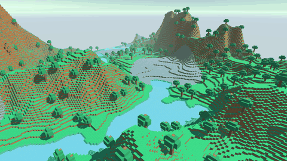
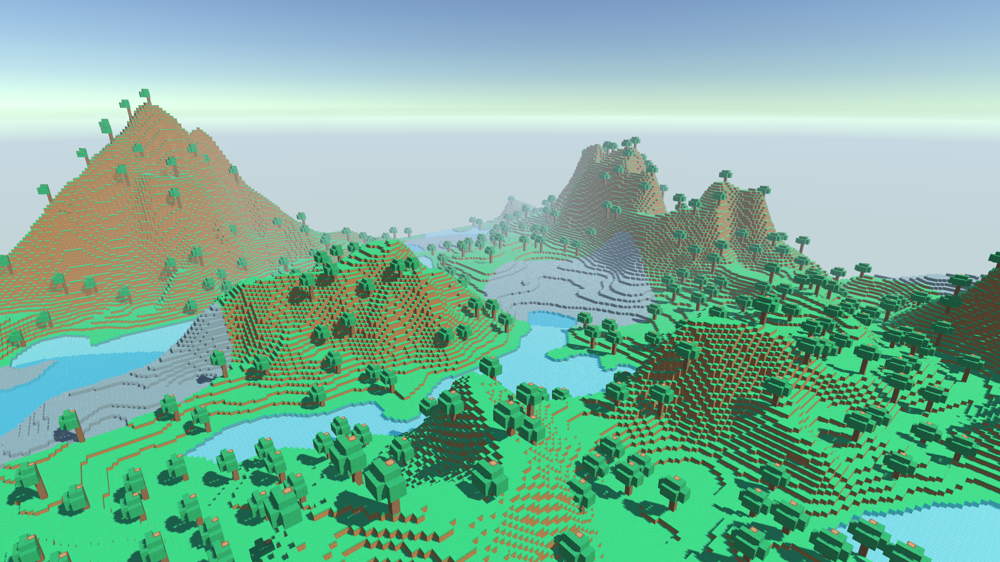
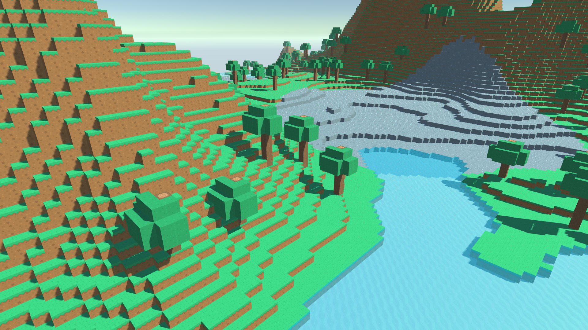
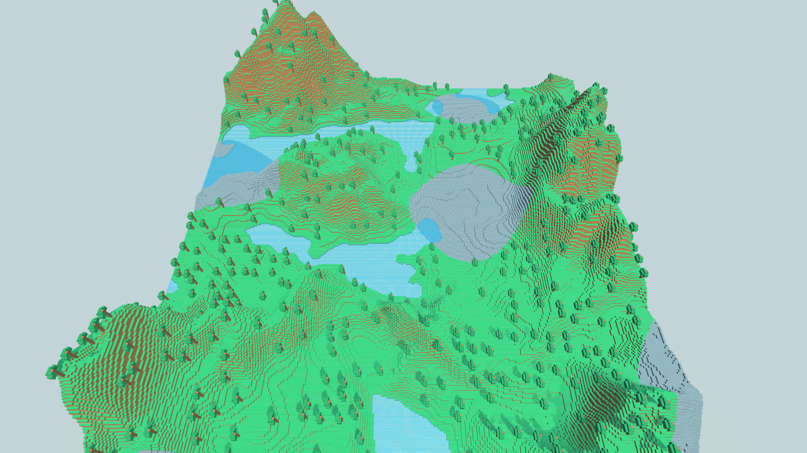
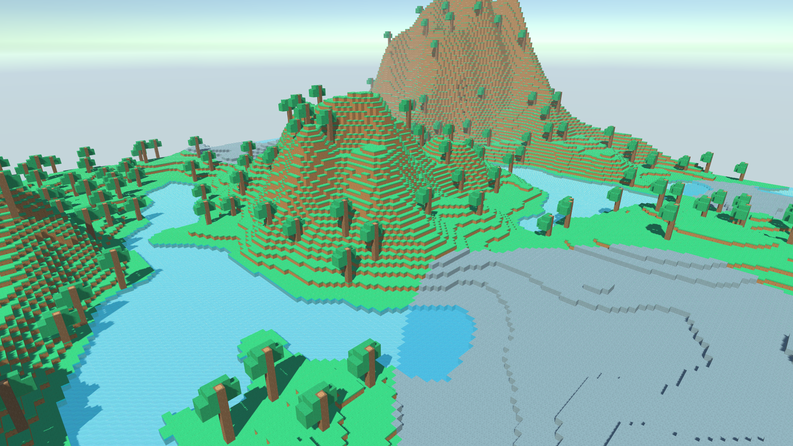
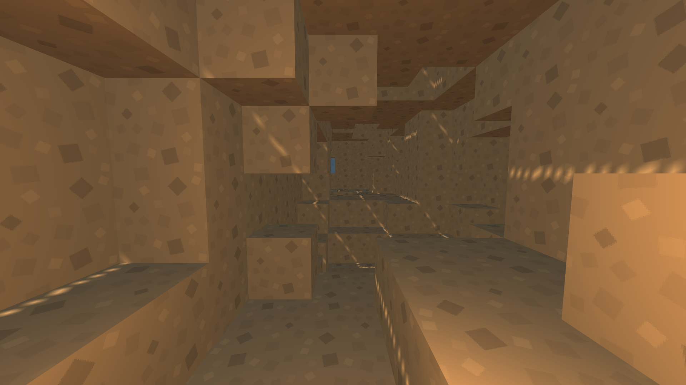

# Voxel Terrain

A chunk-based voxel world in Unity: layered noise terrain with domain warping, caves, trees, water and stone outcrops, greedy-meshed colliders and a per-chunk save system.



## Overview

The world is built from 16 x 100 x 16 block chunks. Each column gets a surface height from octave Perlin noise bent by domain warping, then a chain of block layer handlers fills it: water, air, surface, underground, stone outcrops, caves and trees. Chunks are meshed face by face with a texture atlas, colliders are greedy-merged into large rectangles, and modified chunks are saved to disk and reloaded instead of being regenerated. Generation is spread across frames with a coroutine.

## Features

- Chunked world (16 x 100 x 16), 17 x 17 chunks around the origin plus the chunks below spawn, pooled and reused on regenerate
- Surface height from octave Perlin noise with power redistribution and domain warping
- Chain-of-responsibility block layers: water and sand shores, air, grass surface, dirt underground, stone outcrops, 3D-noise caves, trees
- Trees placed on a jittered grid (one anchor per cell) so canopies never overlap
- Per-face meshing with hidden-face culling across chunk borders and a separate water submesh
- Greedy collider meshing: coplanar collidable faces merged into rectangles
- Binary save system: chunks the player modified are written to disk and loaded back on the next run
- Regenerate and Save buttons, generation on Play, textures from Kenney's Voxel Pack

## How it works

### Terrain generation

`TerrainGenerator.GenerateChunkData` walks each 16 x 16 column of a chunk. `BiomeGenerator.ProcessChunkColumn`:

1. Computes the surface height: `DomainWarping` offsets the sample point by two octave-noise fields (amplitude 80 blocks), `MyNoise.OctavePerlin` samples 2D Perlin noise over several octaves, `MyNoise.Redistribution` applies `pow(noise * modifier, exponent)` to flatten lowlands and sharpen peaks, and the result is remapped to `0..chunkHeight`.
2. Runs the **start layer chain** for every block in the column. Each `BlockLayerHandler` either handles the block or passes it to `Next`: water (below the water level, with sand under it), air (above the surface), surface (grass), underground (dirt).
3. Runs the **additional layers** once per column: stone outcrops where a second noise field passes a threshold, caves carved where 3D noise falls below a threshold (keeping a crust under the surface and a solid floor), and trees.

`TreeDecorationHandler` divides the world into 8 x 8 cells. Each cell has one jittered anchor from a seeded `System.Random`, and a tree grows there only if a density noise passes. Canopies are kept inside their chunk so a neighbor that is not generated yet can't clip them.

`BiomeSelector` can pick between several `BiomeGenerator`s per column from a low-frequency noise map. The included scene uses a single biome.

### Meshing

`Chunk.GetChunkMeshData` visits every block. For each of the six faces it checks the neighbor (inside the chunk directly, across chunk borders through the world's chunk dictionary) and emits a quad only when the neighbor is not solid. UVs come from a texture atlas per block type and face direction. Water faces go into a second submesh with its own material and are only emitted against air.

`GreedyColliderMesher` builds the physics mesh separately. It sweeps each axis, builds a mask of faces where a collidable block meets a non-collidable one, and merges equal mask entries into the largest rectangles it can. On the default seed this gives about 470 collider vertices per chunk against about 1,270 render vertices.

### World management

`World` generates chunk data for a slightly larger area than it renders, so border faces can be culled against real neighbors, then builds meshes nearest-first. Both passes are coroutines with a per-frame budget (8 chunk data, 4 meshes). Chunk GameObjects are pooled. `WorldDataHelper` decides which positions to create and which to drop; dropped chunk data is saved first if the player modified it.

### Key scripts

| File | Role |
|---|---|
| `World.cs` | Chunk dictionaries, generation coroutine, pooling, block edits, save/load hooks |
| `WorldDataHelper.cs` | Which chunk positions to create or remove, block lookups by world position |
| `TerrainGenerator.cs`, `BiomeGenerator.cs`, `BiomeSelector.cs` | Column generation and biome selection |
| `MyNoise.cs`, `DomainWarping.cs`, `NoiseSettings.cs` | Octave Perlin (2D and approximated 3D), redistribution, domain warping |
| `BlockLayers/*.cs` | Water, air, surface, underground, stone, cave and tree layers |
| `Chunk.cs`, `BlockHelper.cs`, `MeshData.cs` | Block access, face culling, quad and UV generation |
| `ChunkRenderer.cs` | Mesh and collider upload per chunk |
| `GreedyColliderMesher.cs` | Greedy-merged collision mesh |
| `SaveSystem.cs` | Binary save/load of modified chunks |
| `BlockDataSO.cs`, `BlockDataManager.cs` | Atlas tiles and solid/collider flags per block type |

## Performance

All numbers were measured in the Unity Editor (Play mode) on an AMD Ryzen 9 7900X / RTX 4070 Ti SUPER. Every measurement uses the same seed (`mapSeedOffset` = 10, 20) and the same spawn view, and generates the full world: 307 rendered chunks and 379 chunk data. "Frame" is the `PlayerLoop` time per frame during generation. GC is the total managed allocation during generation (`GC Allocated In Frame`, summed). Each optimization was checked to produce identical output: the same block hash, render-mesh hash and collider hash.

### Overall

| | Before | After |
|---|---|---|
| Full world generation | 2.35 - 2.41 s | 1.05 - 1.16 s |
| Median frame during generation | 17.4 - 18.1 ms | 5.6 - 6.4 ms |
| Worst frame during generation | 34 - 50 ms | 21 - 36 ms |
| GC allocated during generation | 150 - 161 MB | 93 - 104 MB |
| Meshes loaded after 3 regenerations | 1,305 (leak) | 631 |

These are the results after the optimizations and before the cave/tree retune (last row of the next table). With the retuned world, which has 378 trees and real caves to mesh, full generation takes 1.11 - 1.24 s and allocates 110 MB.

### Step by step

| Change | Measured effect |
|---|---|
| Fix underground chunks copying the surface | Correctness fix; surface chunks unchanged (same hash) |
| Reuse one collision mesh per chunk | Loaded meshes after 3 regenerations: 1,305 → 631 |
| Remove duplicate cave pass | Chunk data: 1.34 → 1.15 ms per chunk |
| Direct voxel lookups in the greedy collider mesher | Collider: 3.09 → 0.57 ms per chunk; generation 2.22 → 1.61 s; median frame 17.3 → 10.5 ms |
| Loop, array and table lookups in chunk meshing | Mesh data: 1.96 → 0.57 ms per chunk; generation 1.61 → 1.14 s; median frame 10.5 → 5.7 ms |
| No LINQ or temporary arrays in mesh upload | GC per generation: 138.0 → 107.8 MB |
| Cache tree anchors per cell | Chunk data: 1.13 → 1.06 ms per chunk; GC 107.8 → 104.8 MB |
| Retune cave and tree thresholds (visual change) | Trees: 2 → 378; generation 1.05 - 1.13 → 1.11 - 1.24 s |

Per-chunk cost now (average of 60 chunks near spawn): chunk data 1.07 ms, mesh data 0.58 ms, collider 0.57 ms, mesh upload 0.10 ms.

Rendering at the default camera view: 993 draw calls (two submeshes per chunk, plus four shadow cascades), about 980 k triangles.

**Why not Jobs + Burst yet:** chunk data is now the largest cost. It is built on `Mathf.PerlinNoise`, which cannot be Burst-compiled. Moving to `Unity.Mathematics.noise` would change the terrain itself, so it is left as the next step rather than done silently.

## Screenshots

| | |
|---|---|
|  |  |
|  |  |
|  | |

## Getting started

- **Unity:** 6000.5.1f1 (Unity 6.5)
- **Render pipeline:** Universal Render Pipeline (URP 17.5)
- **Open:** add the repository folder in Unity Hub and open it with 6000.5.1f1.
- **Scene:** `Assets/VoxelTerrain/Voxel_scene.unity`, then press Play. The world generates on start.
- **Controls:** **Regenerate** rebuilds the world with the current Inspector values (noise settings, thresholds, seed offset on `World`). **Save** writes modified chunks to `Application.persistentDataPath/Saves/World`. The scene has a fixed camera; there is no player controller yet.

## Project structure

```
Assets/
├── VoxelTerrain/
│   ├── Voxel_scene.unity
│   ├── Chunk.prefab
│   ├── Block Data.asset           atlas tiles and block flags
│   ├── Noise settings/            surface, domain warp, stone, cave and tree noise
│   ├── Scripts/
│   │   └── BlockLayers/           water, air, surface, underground, stone, cave, tree
│   ├── Materials/                 procedural sky
│   └── _Textures/                 Kenney Voxel Pack spritesheets, block and water materials
├── Settings/                      URP asset, renderer, global settings
└── TextMesh Pro/                  TMP resources for the UI buttons
Media/
```

## Known limitations and future work

- **No player or streaming yet.** `World.LoadAdditionalChunksRequest` and the create/remove logic in `WorldDataHelper` support loading chunks around a moving player, but the scene has no player, so only the area around the origin is generated.
- **Main-thread generation.** Work is spread over about 120 frames by fixed per-frame counts. A time budget per frame, or Jobs + Burst with `Unity.Mathematics` noise, would remove the remaining spikes.
- **Single biome in the scene.** `BiomeSelector` is implemented but not wired up.
- **Approximate 3D noise.** Caves use the average of six 2D Perlin planes, which compresses the value range; the cave threshold had to be tuned to that range.
- **Per-face render meshes.** Faces are not greedy-merged for rendering (only for physics), so draw meshes are larger than necessary, and point lights can leak through the seams between neighboring quads.
- **Save format.** Each block is stored as a 4-byte int, and saves are not keyed by seed, so changing the seed loads old edits.

## Credits

- Textures: [Kenney Voxel Pack](https://kenney.nl/assets/voxel-pack) by Kenney (kenney.nl), CC0 1.0.
- Font: Roboto Bold (Apache License 2.0), via TextMesh Pro.

## License

MIT, © 2026 Gokul Senthil. See [LICENSE](LICENSE).
